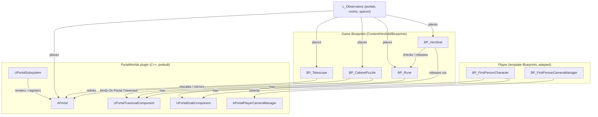

# Hexfold architecture

How the game is put together: the layers it's built from, the custom Blueprints and what each one is responsible for, how they talk to each other at runtime, and how the level and art are organised.

For the game design and milestones, see [`Design/Plan.md`](Design/Plan.md). For the portal plugin itself, see [`PortalWorlds/`](PortalWorlds/README.md).

## Layers

Hexfold is Blueprint-only. All C++ lives in the PortalWorlds plugin, which ships prebuilt and isn't edited in this project.

| Layer | Where | What it does |
|---|---|---|
| PortalWorlds plugin | `Plugins/PortalWorlds/` | Portal rendering, traversal (moving, scaling and mirroring whatever crosses), grabbing through portals, and spaces. |
| Player | `Content/FirstPerson/Blueprints/` | The UE first-person template, adapted to use the plugin. |
| Game Blueprints | `Content/Hexfold/Blueprints/` | Runes, the hex seal, and the logic for the two puzzles that need scripting. |
| Level | `Content/Levels/L_Observatory` | The Observatory, Rotunda and six wings; all portal pairs and their links; puzzle placement. |
| Art | `Art/Blender/` → `Content/Hexfold/Meshes/` | Meshes generated by Python scripts in Blender, exported as FBX and imported. |

Most puzzles need **no scripting at all**. The chasm window and both size puzzles are just portal pairs with the right scales and links, and the mirror gallery adds a negative scale. Only the cabinet sequence and the telescope dial need Blueprint logic.

## Custom Blueprints

| Blueprint | Parent | Responsibility |
|---|---|---|
| [`BP_Rune`](#bp_rune) | `Actor` | A rune: a physics object that can be carried, thrown, pushed, and sent through portals. It carries its identity (`RuneIndex`). |
| [`BP_HexSeal`](#bp_hexseal) | `Actor` | The hex over the Rotunda door: seals the player in, checks runes placed in its six sockets, and opens the door when all are in. |
| [`BP_CabinetPuzzle`](#bp_cabinetpuzzle) | `Actor` | Rune 2: tracks the order in which the player visits the closet through the three cabinets, and relinks the cabinets so the right sequence opens the vault. |
| [`BP_Telescope`](#bp_telescope) | `Actor` | Rune 6: three floor plates (the dial) that set the lens portal to mirror, halve or double whatever comes through the eyepiece. |

### BP_Rune

**Responsibility:** be a rune. It holds no game logic beyond knowing which rune it is and making a mirrored placement count as mirrored.

| Part | Details |
|---|---|
| Components | `Mesh` (root, static mesh: Movable, Simulate Physics, `PhysicsActor` profile, overlap events on, **Can Character Step Up On = No** so the player pushes it instead of climbing it). `PortalTraversal` (plugin; moves, scales and mirrors the rune when it crosses a portal, and cuts it at the portal plane). |
| Variables | `RuneIndex` (int, instance editable): 0–5, which socket it belongs in. |
| BeginPlay | If the actor's X scale is negative, calls **Set Mirrored (true)** on its Portal Traversal, so a rune placed mirrored in the level is treated as mirrored. |
| Per instance | `StaticMesh` = `SM_Rune_<RuneIndex>`, actor scale (e.g. 2 for the heavy rune, (−0.5, 0.5, 0.5) for the telescope rune), and a `PortalSpace.<n>` tag for the room it starts in. |
| Used by | `BP_HexSeal` (reads index, scale, mirrored state; snaps it into a socket). The player's Portal Grab (carry, throw). |

A rune's state that matters to the game lives entirely in the engine: its **world scale** (actor scale) and its **mirrored flag** (Portal Traversal's **Is Mirrored**). Portals change both; nothing else needs to track them.

### BP_HexSeal

**Responsibility:** the win condition. It seals the player in, judges runes, and opens the door.

| Part | Details |
|---|---|
| Components | `HexRoot` → `Web` (`SM_Hex_Ring`), `Plate0`–`5` (`SM_Hex_SocketPlate`), `Glyph0`–`5` (`SM_Glyph_N`): visuals, hidden until sealed. `Trigger0`–`5`: socket triggers, 20 cm in front of each socket. `Barrier`: a blocking box across the doorway, collision off until sealed. `SealTrigger`: a box 4 m into the Rotunda that seals the door when the player walks in. |
| Variables | `SocketEnabled` (bool ×6, instance editable), `SocketFilled` (bool ×6), `bSealed`, `bBroken`, and the `Plates` / `Glyphs` / `Triggers` component arrays (filled in BeginPlay). |
| Events | BeginPlay: barrier off, visuals hidden, arrays filled. `SealTrigger` overlap by the player character → `SealDoor`. `Trigger<k>` overlap by a `BP_Rune` → `TryPlace(Rune, k)`. |
| Functions | `SealDoor`: show the web and enabled sockets, turn the barrier on. `TryPlace`: check, in order: sealed and not broken, socket enabled and empty, `RuneIndex == k`, \|scale Z\| within 0.9–1.1, not **Is Mirrored**. Then `AcceptRune` or `RejectRune`. `AcceptRune`: release it from the player's grab, turn off physics and collision, snap it in front of the glyph, light the plate, mark the socket filled, and call `BreakHex` if `AllFilled`. `RejectRune`: release it, push it back into the room, and print the reason (wrong rune, wrong size, mirror image). `BreakHex`: hide everything and turn the barrier off. `ReleaseIfHeld`: if the player's Portal Grab holds this rune, release it. `AllFilled`: every enabled socket is filled. |
| Placement | In the Rotunda at (50000, 1960, 150), yaw 180 (front faces into the room), just inside the entrance portal. All six sockets enabled. |

Feedback is `Print String` for now (milestones 6–7 add proper effects).

### BP_CabinetPuzzle

**Responsibility:** rune 2's puzzle state machine. It's the only Blueprint that reacts to portal crossings.

| Part | Details |
|---|---|
| Variables | `Cabinets` (Portal ×3, instance editable: Mercury, Venus, Mars), `ClosetDoor`, `VaultDoor` (Portal), `Sequence` (int array, instance editable: [2, 1, 0] = Mars, Venus, Mercury), `Progress` (int). |
| BeginPlay | After a 0.5 s delay (so the player pawn exists), binds the player's Portal Traversal **On Portal Traversed** to a custom event, sets the closet and vault doors' initial links, and calls `UpdateLinks`. |
| `HandleTraversal(From, To, Scale)` | Called on every player crossing; ignores crossings that don't start at a cabinet. Cabinet → closet: link the closet door back to that cabinet; advance `Progress` if it's the next cabinet in `Sequence`, otherwise reset it (to 1 if it's the first in the sequence, else 0); print "clicks forward", "turns into alignment" or "grinds back". Cabinet → vault: link the vault door back to that cabinet and reset `Progress`. Always ends with `UpdateLinks`. |
| `UpdateLinks` | Points every cabinet's links at the closet door, except the last cabinet in the sequence, which points at the vault door once `Progress` reaches the last step. |
| Placement | In the study (space 3), at (110000, 600, 0). |

The binding uses the `AssignOnPortalTraversed` node, which creates a custom event with the delegate's exact signature. Binding a regular Blueprint function doesn't work, because the delegate's `ScaleFactor` is a single-precision float.

### BP_Telescope

**Responsibility:** rune 6's dial. It changes one portal's transform at runtime, which changes what that portal does to anything passing through.

| Part | Details |
|---|---|
| Components | `Plate0`–`2` (coloured discs), `Trigger0`–`2` (pawn-only overlap boxes), `Label0`–`2` (text): Gemini, Lynx and Cygnus, at x = +4.5, +7.5 and +10.5 m. |
| Variables | `Lens` (Portal), `LensFrame` (Actor), `LensBase` (Vector: where the lens stands), all instance editable; `Setting` (int, −1 at start = plain 1:1). |
| Events | `Trigger<k>` overlap by the player character → `ApplySetting(k)`. |
| `ApplySetting(i)` | If `i` is new: set the lens and frame to scale (−1, 1, 1) (Gemini, mirror), 0.5 (Lynx) or 2 (Cygnus), raised so they stand on the floor, and print the constellation. |
| Placement | In the telescope room (space 9), at (290000, 700, 0), next to the eyepiece. |

The eyepiece and lens are ordinary portals placed in the level: the eyepiece's front links to the lens, and the lens's back links to the eyepiece. Because the eyepiece stays at scale 1, the lens's scale *is* the transform applied to whatever comes through.

## Template Blueprints (adapted)

| Blueprint | Change for Hexfold |
|---|---|
| `BP_FirstPersonCharacter` (`Character`) | Has a **Portal Traversal** component (crosses portals; scaled and mirrored by them) and a **Portal Grab** component (carry and throw, also through portals). Input: `IA_Grab` → **Toggle Grab**, `IA_Throw` → **Throw**. Portal Grab **Max Object Radius** = 45 cm, so a 2× rune can't be lifted but every 1× rune can. |
| `BP_FirstPersonCameraManager` | Parent changed to **PortalPlayerCameraManager**, which renders the portal views each frame and reverses mouse yaw while the player is mirrored. |
| `BP_FirstPersonPlayerController`, `BP_FirstPersonGameMode` | Unchanged from the template. The game mode is the project's global default. |

## Plugin classes used

| Class | Used for |
|---|---|
| `APortal` | Every doorway, window, cabinet, eyepiece and lens. **Front Link** / **Back Link** choose where each side leads; the actor's scale sets the size change and mirroring. |
| `UPortalTraversalComponent` | On the player and on every rune. Fires **On Portal Traversed** (used by `BP_CabinetPuzzle`); **Is Mirrored** (read by `BP_HexSeal`); **Set Mirrored** (used by `BP_Rune`); **Reset Tracking** (used by `BP_HexSeal` after snapping a rune). |
| `UPortalGrabComponent` | On the player. `BP_HexSeal` calls **Get Held Component** and **Release**. |
| `APortalPlayerCameraManager` | Parent of the project's camera manager. |
| `UPortalSubsystem` | Implicit: registers portals, renders views, assigns spaces. Nothing in Hexfold calls it directly. |

## Runtime flows

**Entering and sealing.**
1. The player walks through `Portal_Entrance_Out` (outside, space 0) and comes out of `Portal_Entrance_In` (Rotunda, space 1). Both are 3 × 3 m (scale 1.5).
2. 4 m into the room, `BP_HexSeal.SealTrigger` fires → `SealDoor`: the web appears and the barrier blocks the doorway.

**Placing a rune.**
1. The player carries a `BP_Rune` (Portal Grab) or throws it into a socket trigger.
2. `TryPlace` checks it. If it passes, `AcceptRune` takes it out of the player's hands and locks it in.
3. When `AllFilled` → `BreakHex` → the barrier is removed, and the player can walk back out through the entrance portal.

**Changing a rune.** Nothing in Blueprint changes a rune's size or handedness. Portals do:
- A portal pair of different sizes rescales it (scale ratio = exit / entry).
- A pair where exactly one portal has negative X scale mirrors it.
- A carried rune changes along with the player, so the world-space result is the same whether it's carried or thrown.

**Cabinet sequence.** Player crossing → Portal Traversal broadcasts **On Portal Traversed** → `BP_CabinetPuzzle.HandleTraversal` → `Progress` and links updated → the next cabinet door shows (and leads to) the closet or the vault.

**Telescope dial.** Player steps on a plate → `BP_Telescope.ApplySetting` → the lens portal's scale changes → the next trip through the eyepiece applies the new transform.

## Level structure

`L_Observatory` is the editor and game default map. Rooms that share an apparent location are built far apart and separated with **spaces** (actor tag `PortalSpace.<n>`). Lights, sky and the player are untagged and appear in every space.

| Space | Area | Origin (cm) | Reached from |
|---|---|---|---|
| 0 | Outside: ground and Observatory exterior | (0, 0, 0) | Start |
| 1 | Rotunda (hex, entrance) | (50000, 0, 0) | Entrance portal |
| 2 | Rune 1: chasm | (80000, 0, 0) | Alcove 7 |
| 3 | Rune 2: study | (110000, 0, 0) | Alcove 6 |
| 4 | Rune 2: closet | (140000, 0, 0) | Cabinets |
| 5 | Rune 2: vault | (170000, 0, 0) | Mercury cabinet (when aligned) |
| 6 | Rune 3: push hall | (200000, 0, 0) | Alcove 5 |
| 7 | Rune 4: mouse room | (230000, 0, 0) | Alcove 3 |
| 8 | Rune 5: mirror gallery | (260000, 0, 0) | Alcove 2 (mirroring) |
| 9 | Rune 6: telescope room | (290000, 0, 0) | Alcove 1 |

Alcoves are numbered *k* = 0–7 in 45° steps around the Rotunda from the entrance (*k* = 0); *k* = 4 is an empty niche.

**Portal conventions.**
- Every portal sits on the inner face of a wall opening with a 1 m recess behind it, so the player's capsule reaches the portal before it hits anything.
- A doorframe (`SM_Obs_Doorframe`) at the same transform hides the portal's edge.
- Rotunda-to-wing pairs are 4 × 4 m (scale 2 both ends). The alcove portal's local +Y points out of the Rotunda, and the wing portal (yaw 0) faces into the wing, so the player keeps walking forward.
- One-way windows (the chasm, the mirror gallery) link only the side you look through, with a backing plate over the other side.

## Asset pipeline

Meshes are generated, not hand-modelled, so they can be rebuilt and reviewed:

1. `Art/Blender/scripts/build_*.py` builds a group of meshes in its `.blend` file (`Runes`, `Observatory_Exterior`, `Rotunda`, `Hex`, `Wings`).
2. `export_fbx.py` exports every top-level `SM_*` object to `Art/Export/<group>/` at the origin, with its `UCX_*` collision children.
3. The Unreal MCP's `StaticMeshTools.import_file` imports them into `Content/Hexfold/Meshes/<group>/`. Runes and the doorframe use `UCX` convex collision; rooms use complex-as-simple collision.

Greybox materials are the `MI_PrototypeGrid_*` instances from `LevelPrototyping`. Runes, glyphs, the hex web and the planet markers use instances of `M_PhysicsCube_PortalClip` (`Content/Hexfold/Materials/`), so anything that passes through a portal is cut at the portal plane.

## Adding a rune puzzle

1. Build the room in `build_wings.py` (an entrance door in the −Y wall at scale 2, plus any doors and windows), export, and import.
2. Place it far from the others in a new space, tag every actor `PortalSpace.<n>`, and connect it to a Rotunda alcove with a scale-2 portal pair.
3. Place a `BP_Rune` with the right `RuneIndex`, mesh, starting scale and tag.
4. If the puzzle is only portals (sizes, mirrors, links), it needs no Blueprint. If it needs state (sequences, switches), follow `BP_CabinetPuzzle` (react to crossings) or `BP_Telescope` (react to triggers by changing portals).
5. Make sure the socket is enabled in `BP_HexSeal.SocketEnabled`.

Editor-tool gotchas (MCP quirks, PIE testing, the graph DSL) are collected in [`CLAUDE.md`](../CLAUDE.md).
