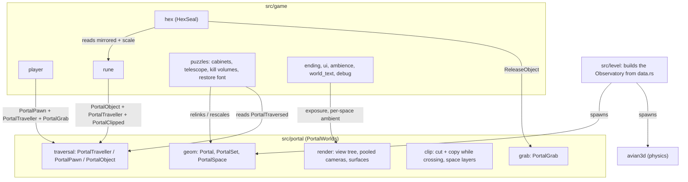

# Hexfold architecture

How the game is put together: the layers, the game systems and what each is responsible for, how they talk to each other at runtime, and how the level and art are organised.

For the game design, see [`Design/Plan.md`](Design/Plan.md) (written for the Unreal version; the puzzle design is unchanged, and its first section lists where the Bevy version differs). For the portal plugin itself, see [`PortalWorlds/README.md`](PortalWorlds/README.md). Every module, type and function also has doc comments: `cargo doc --no-deps --document-private-items --open`.

## Layers

Hexfold is one Rust crate on Bevy 0.20 and avian3d 0.8. The portal plugin and the game are separate modules, and the plugin doesn't know about the puzzles.

| Layer | Where | What it does |
|---|---|---|
| PortalWorlds plugin | `src/portal/` | Portal rendering, traversal (moving, scaling and mirroring whatever crosses), grabbing through portals, and spaces. |
| Level | `src/level/` | Spawns the Observatory, Rotunda and six wings, every portal pair and its links, lights and colliders, from placement data exported from the Unreal level. |
| Game | `src/game/` | The player, runes, the hex, the two scripted puzzles, safety nets, the ending, HUD, menus, sound and the test driver. |
| Art | `art/Blender/` -> `assets/models/` | Meshes generated by Python scripts in Blender, exported as FBX and converted to glTF. |

Most puzzles need **no scripting at all**. The chasm window and both size puzzles are just portal pairs with the right scales and links, and the mirror gallery adds a negative scale. Only the cabinet sequence and the telescope dial have logic.

## Game systems

`HexfoldPlugin` (`src/game/mod.rs`) spawns everything in one chained `Startup` set and runs the game's systems in `Update`. The exceptions: `player::update_body` runs in `PostUpdate` after the plugin has placed the camera, `debug::trace` runs in `Last`, and the plugin's own work runs in `PostUpdate` after physics (see [the plugin guide](PortalWorlds/README.md#frame-order)). Time is paused (`Time<Virtual>`) on every screen but `Playing`.

| System | Responsibility |
|---|---|
| `player` | A flat-bottomed chamfered cylinder (a dynamic avian body with locked rotation), held 2.5 cm above the floor by ground rays so it never rests on floor contacts. Mouse look, walking, jumping. Movement, gravity, collider and mass scale with the player's size (`PortalPawn::scale`); mouse yaw and strafing are reversed while mirrored. The player doesn't collide with runes, and can lift objects up to 0.45 m in radius at their size (a 1x rune, but the 2x heavy rune only once grown to 2x). A body model (`SM_Player`) follows the player and is drawn only by portal views, so you see yourself through a portal but never from inside your own head. |
| `rune` | Spawns the six runes: a rigid body with a hexagonal hull and swept CCD, a `visual` child (two meshes: strokes and plate) that carries the mirror flip, `PortalObject` + `PortalTraveller` + `PortalClipped`. `ReturnToPedestal` puts one back where it started. |
| `hex` | The win condition. A trigger 4 m into the Rotunda seals the door (web, sockets and barrier appear). A rune entering a socket trigger is checked in order: right rune, size within 10% of 1, not mirrored. Accepted: released from the player's hands, frozen in the socket, plate and glyph lit. Rejected: pushed gently out, its plate flashes, a message says why. All six: the hex breaks. |
| `puzzles::CabinetPuzzle` | Rune 2. Tracks the order of cabinets visited (reads `PortalTraversed`) and relinks the portals: every cabinet leads to the closet, except the last one in the sequence, which leads to the vault once the earlier steps are done. |
| `puzzles::Telescope` | Rune 6. Three floor plates set the lens portal's scale to mirror, halve or double whatever comes through the eyepiece. Only the lens portal is mirrored; its frame keeps a positive scale (a mesh with a negative scale renders inside out). |
| `puzzles::KillVolume` | A box per space far below the floor (plus the chasm pit). A rune touching it returns to its pedestal; the player is put back at the volume's respawn point (1x, unmirrored, `PlayerSpace` updated). |
| `puzzles::RestoreFont` | A pad in the Rotunda that restores the player to normal size and unmirrored. |
| `ending` | The sky (a vertex-coloured gradient dome with an additive star dome inside it), the moonlight and a faint dusk sun, all outside only. After the hex breaks, a 12 s sunrise: the moon turns gold and sinks, the sky turns orange, the stars fade, the outdoor ambient light warms. Walking back outside shows the escape screen two seconds later. |
| `adapt_exposure` (`mod.rs`) | The eye adapts smoothly (a time constant of about 0.7 s): EV100 0 outside at night, 3.5 indoors (and outside after the sunrise). Written to both the player camera and `PortalSettings::exposure_ev100`, so portal views expose the same way. |
| `ui` | HUD (six rune slots, crosshair, message line fed by `Toast` messages), and the title, pause and escape screens. Restart relaunches the executable. |
| `ambience` | Wind outside, a hum inside (crossfaded by `PlayerSpace`), and footsteps while walking. |
| `world_text` | Text in the world (mural numerals, the mirror gallery's inscription, the dial's names), baked once into textures by throwaway 2D cameras and shown on quads. |
| `mats` | The shared materials (rune gold and plate, socket plates and glyphs, the hex web, the font pad). |
| `debug` | The scripted driver for automated checks (`HEXFOLD_SCRIPT`) and the per-frame trace (`HEXFOLD_TRACE`). See the [README](../README.md#automated-checks). |

A rune's state that matters to the game lives entirely in the engine: its **world scale** (the root's uniform scale) and its **mirrored flag** (`PortalTraveller::mirrored`). Portals change both; nothing else needs to track them.

The game's portal settings: recursion depth 6 (`max_depth`), resolution falloff 0.75, 10 pooled view cameras per depth created up front (`prewarm_per_depth`), and a separate ambient light for space 0 (outside) that the ending changes.

### Physics layers

`level::Layer`:

| Layer | What | Collides with |
|---|---|---|
| `World` | Room shells, frames, cubes, the hex barrier (while sealed) | Player, props |
| `Player` | The player body | World, triggers |
| `Prop` | Runes | World, props, triggers (while held: world and triggers only) |
| `Trigger` | Sensors: seal, sockets, dial plates, kill volumes, font | Whatever each one watches |

## Runtime flows

**Entering and sealing.**
1. The player walks through `Portal_Entrance_Out` (outside, space 0) and comes out of `Portal_Entrance_In` (Rotunda, space 1). Both are 3 x 3 m (scale 1.5).
2. 4 m into the room, the `HexSeal`'s seal trigger fires: the web appears and the barrier blocks the doorway.

**Placing a rune.**
1. The player carries a rune (`PortalGrab`) or throws it into a socket trigger. A held rune still touches triggers, so it can be seated without letting go.
2. `hex_logic` checks it. If it passes, it takes the rune out of the player's hands (a `ReleaseObject` message) and locks it in.
3. When every socket is filled, the barrier is removed and `HexEvent::Broken` starts the sunrise.

**Changing a rune.** Nothing in game code changes a rune's size or handedness. Portals do: a portal pair of different sizes rescales it, a pair where exactly one portal has negative X scale mirrors it, and a carried rune changes along with the player.

**Cabinet sequence.** The player crosses a portal -> traversal sends `PortalTraversed` -> `cabinet_logic` updates its progress and links -> the next cabinet door leads to the closet or the vault.

**Telescope dial.** The player steps on a plate -> `telescope_logic` changes the lens portal's scale -> the next trip through the eyepiece applies the new transform.

## Level structure

The level is `src/level/data.rs`: every placed actor of the Unreal level `L_Observatory`, in Unreal units, converted to Bevy at spawn (`src/ue.rs`). It is generated by `tools/gen_level_data.py` from the dumps in `tools/unreal_dump/`; the generator also lowers the exterior 20 cm onto the ground (the Unreal level had the door standing on a step). Rooms that share an apparent location are built far apart and separated with **spaces** (`PortalSpace(n)`).

| Space | Area | Origin (Unreal cm) | Reached from |
|---|---|---|---|
| 0 | Outside: ground and Observatory exterior | (0, 0, 0) | Start |
| 1 | Rotunda (hex, entrance) | (50000, 0, 0) | Entrance portal |
| 2 | Rune 1: chasm | (80000, 0, 0) | Alcove 7 |
| 3 | Rune 2: study | (110000, 0, 0) | Alcove 6 |
| 4 | Rune 2: closet | (140000, 0, 0) | Cabinets |
| 5 | Rune 2: vault | (170000, 0, 0) | Mercury cabinet (when aligned) |
| 6 | Rune 3: push hall | (200000, 0, 0) | Alcove 5 |
| 7 | Rune 4: mouse room | (230000, 0, 0) | Alcove 3 |
| 8 | Rune 5: mirror gallery | (260000, 0, 0) | Alcove 2 (mirroring) |
| 9 | Rune 6: telescope room | (290000, 0, 0) | Alcove 1 |

Alcoves are numbered k = 0-7 in 45 degree steps around the Rotunda from the entrance (k = 0); k = 4 is an empty niche.

Static meshes, portals and lights come from the level data (`level::spawn_level`). The gameplay actors (runes, hex, dial, kill volumes, font, sky, text) are built by the game modules; `LevelIndex` maps Unreal actor names to entities so they can find the portals they drive.

**Portal conventions.**
- Every portal sits on the inner face of a wall opening with a 1 m recess behind it, so the player's body reaches the portal before it hits anything.
- A doorframe mesh at the same transform hides the portal's edge.
- Rotunda-to-wing pairs are 4 x 4 m (scale 2 at both ends).
- One-way windows (the chasm, the mirror gallery) link only the side you look through.

## Asset pipeline

Meshes are generated, not hand-modelled, so they can be rebuilt and reviewed:

1. `art/Blender/scripts/build_*.py` builds a group of meshes in its `.blend` file (`runes`, `observatory`, `rotunda`, `hex`, `wings`, `outdoor`, `player`).
2. `export_fbx.py` exports every top-level `SM_*` object to `art/Export/<group>/`.
3. `export_glb.py` converts those FBX files to glTF in `assets/models/<group>/` (run headless: `blender -b --python art/Blender/scripts/export_glb.py`). Collision hulls (`UCX_*`) are dropped: the game builds colliders itself (triangle meshes for rooms, a convex hull for runes and the player).

The Blender -> glTF export uses the same axis mapping as `src/ue.rs`, so a mesh placed with an Unreal transform looks the same as it did in Unreal.

Greybox materials are flat colours chosen in `src/level/mod.rs`. Runes use `ClipMaterial` (a `StandardMaterial` extension that discards fragments behind a world-space plane), so anything partway through a portal is cut at the portal plane. Shaders are WESL files in `assets/shaders/` (`portal_surface.wesl`, `portal_clip.wesl`).
